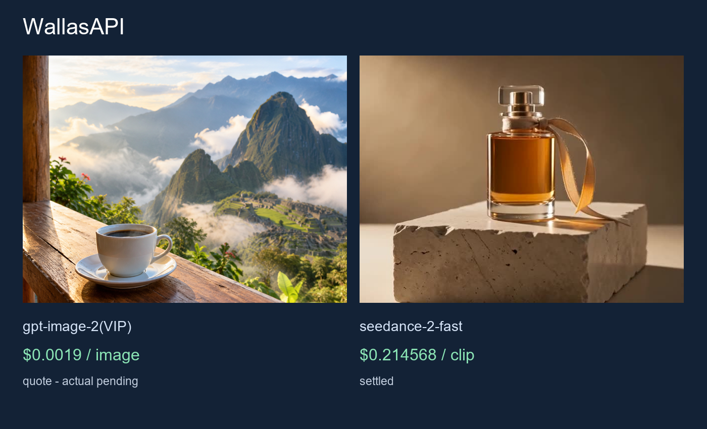

# WallasAPI con API de menor coste

Probamos llamadas independientes de imagen y vídeo y el formato de archivos del router. El proveedor todavía no está registrado en WallasAPI. Hay que añadir una rama explícita y revisar el fallback para que una solicitud de pago incierta no se envíe dos veces. No se modifican los proveedores ni enlaces actuales. Atribución visible: Willen Ponce.

[English: full guide](README.md) · [API parameters and prices](PRICING.md)



# Corresponding API pricing

| Model | Parameters | API price | This case |
|---|---|---|---|
| gpt-image-2(VIP) | n=1, size=1:1, resolution=1K, quality=low | $0.0019/image | $0.0019 quote; actual pending |
| seedance-2-fast | duration=4, resolution=480p, aspect_ratio=16:9, generate_audio=False | $5.285714/M tokens | $0.214568 settled; MP4 4.04s; $0.053111/s observed |

Rates queried with the generation API Key on 2026-10-22. Quotes are not settled charges. For token-metered video, $/M is the billing rate; observed $/s = this case’s settled cost / decoded MP4 duration and is not a fixed future price. gpt-image-2(VIP) low/1K starts at $0.0019/image. No comparative quality, uptime or savings benchmark is claimed.


## Prueba

1. Configura TOAPIS_API_KEY de forma privada.
2. Consulta primero el precio sin --live.
3. Añade --live y un --run-id estable solo para una solicitud aprobada.
4. Repetir la misma entrada continúa la tarea guardada.
5. Guarda PNG/MP4 y distingue el precio consultado del cargo confirmado.

```sh
python unified_client.py --model gpt-image-2-vip --prompt-file prompts/image.txt --max-usd .10
# Add --live --run-id reviewed-case only for a paid request
```

[Provider details](integration/README.md)

[ToAPIs](https://go2v.toapis.com/1022_wa) · 1022_wa
